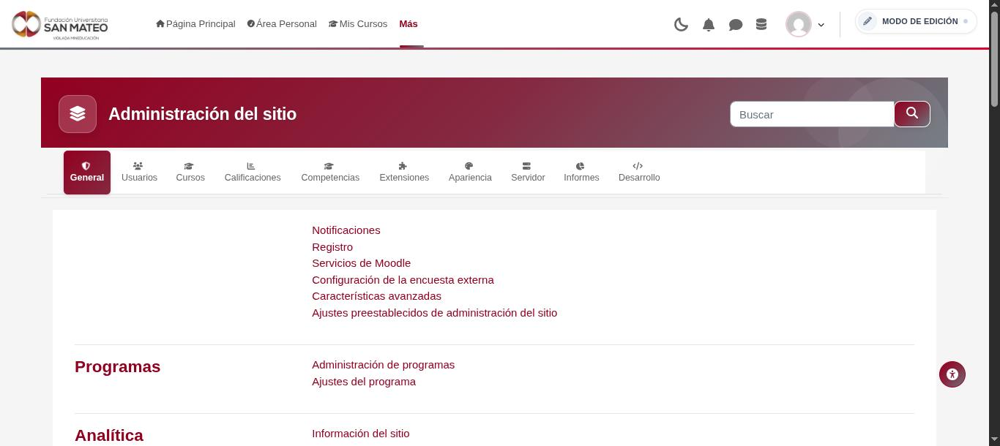

<div align="center">


<br>

# ⚡ Theme Active

### A modern, student-first Moodle theme that turns every course into an experience.

[](https://moodle.org)
[](https://www.php.net)
[](https://getbootstrap.com)
[](https://www.gnu.org/licenses/gpl-3.0)

**Bold headers · Real-time progress · Dark mode ready · Fully brandable**

<br>



</div>

---

## ✨ Why Theme Active?

Most Moodle sites look the same. **Theme Active** gives your platform its own identity and puts what
students care about first: *where am I, what is left, and who is my teacher?*

Built on top of **Boost**, it keeps everything Moodle users already know, and adds a polished layer of
navigation, progress tracking and branding that works out of the box.

<table>
<tr>
<td width="33%" valign="top">

### 🎨 Your brand, everywhere
Primary, secondary, accent and footer colors, your own header banner and symbol.
Change them from the admin panel. No code needed.

</td>
<td width="33%" valign="top">

### 📈 Progress you can see
Students always know how far they are: progress bar in the course, progress on every
course card, and a full progress page.

</td>
<td width="33%" valign="top">

### 🌙 Light and dark
Every theme component has a dark version. Works with
[local_boost_dark](https://moodle.org/plugins/local_boost_dark) and stays readable in both modes.

</td>
</tr>
</table>

---

## 🚀 Features

### 🏛️ Course header
- **Institution banner** for pages and courses without their own image, with your logo always visible.
- **Course image as background** when the course has one.
- **Teacher avatars** right in the header: up to 4 faces, a counter for the rest, and the full list
  (with links to their profiles) in one click.
- **Activity dates and completion status** as clear pills next to the title.
- **Smart breadcrumb**: long paths are shortened, and on mobile the middle levels fold into a `…` button.

### 📊 Course progress
- 🟢 **Progress bar** at the top of every course for tracked students.
- 🃏 **Progress on course cards** in course listings and on the user's own profile.
- 📋 **Progress page** with activities grouped by section, completion requirements, deadlines,
  overdue items and teacher contacts. Ready to print or export.

### 🧭 Navigation
- ⬅️➡️ **Previous / next activity** buttons with the activity name, icon and position ("3 of 12").
- 📚 **Book navigation** with chapter titles, a chapter map and "chapter X of Y".
- 💬 **Forum navigation** with cards for the previous and next discussion.
- 🗂️ **Complete course index**: also lists stealth and "entirely hidden" restricted activities, so
  nothing gets lost (only activities hidden by the teacher are left out).
- 📅 **Calendar tab** inside the course, with a "Back to course" button.

### 🏠 Dashboard and site
- ⚡ **Quick links**: up to 6 configurable shortcuts on the dashboard, with icon, label and URL.
- 🦶 **Rich footer**: social networks (Facebook, X, Instagram, LinkedIn, YouTube, TikTok),
  Moodle app download buttons and site info.
- 🔐 **Clean login page** with configurable form position (left, center or right).
- 🛠️ **Friendly maintenance page** that looks intentional, not like an error.

### ⚙️ Under the hood
- 🚄 **Fast**: teachers, course images and progress are cached and refreshed automatically by events.
- 🔒 **Privacy API compliant**: the theme stores no personal data.
- 🌍 **Translated**: English, Spanish and Spanish (Colombia).
- 🧩 **Light mode for guests**: visitors without an account always see the site in light mode.

---

## 🎛️ Settings

Everything is under **Site administration › Appearance › Themes › Active**, split into 6 tabs:

| Tab | What you can change |
|---|---|
| 🎨 **General** | Content width, primary color, secondary color, accent color, footer color, progress on course cards |
| 🏷️ **Branding** | Header banner and header symbol (theme defaults are loaded, replace them with yours) |
| 🔐 **Login** | Login form position (left, center or right) |
| ⚡ **Quick links** | Up to 6 dashboard shortcuts: label, URL, icon and target |
| 🦶 **Footer** | Social network URLs and Moodle app links (Android and iOS) |
| 🧪 **Advanced** | Raw initial SCSS and raw SCSS for custom styles |

> 💡 **Tip:** leave the accent and footer colors empty and the theme builds them from your secondary color.

---

## 📦 Installation

### Option 1: Upload a ZIP

1. Go to **Site administration › Plugins › Install plugins**.
2. Upload the ZIP file.
3. Check the validation report and finish the installation.

### Option 2: Manual

Copy this folder to:

```text
{your/moodle/dirroot}/theme/active
```

Then open **Site administration › Notifications**, or run:

```bash
php admin/cli/upgrade.php
```

### Then

1. Select the theme in **Site administration › Appearance › Themes**.
2. Set your colors and images in the theme settings.
3. Purge caches if you change files by hand: `php admin/cli/purge_caches.php`.

---

## 📋 Requirements

| | |
|---|---|
| **Moodle** | 5.0 or later |
| **Parent theme** | Boost (included in Moodle) |
| **Optional** | [local_boost_dark](https://moodle.org/plugins/local_boost_dark) for the dark mode toggle |

---

## 📄 License

**© 2024 Jhon Rangel**

This program is free software: you can redistribute it and/or modify it under the terms of the
GNU General Public License as published by the Free Software Foundation, either version 3 of the
License, or (at your option) any later version.

This program is distributed in the hope that it will be useful, but WITHOUT ANY WARRANTY; without even
the implied warranty of MERCHANTABILITY or FITNESS FOR A PARTICULAR PURPOSE. See the
[GNU General Public License](https://www.gnu.org/licenses/) for more details.

<div align="center">

<br>

**Made with ❤️ for teachers and students at the Fundación Universitaria San Mateo.**

⭐ If Theme Active helps your platform, give it a star!

</div>
